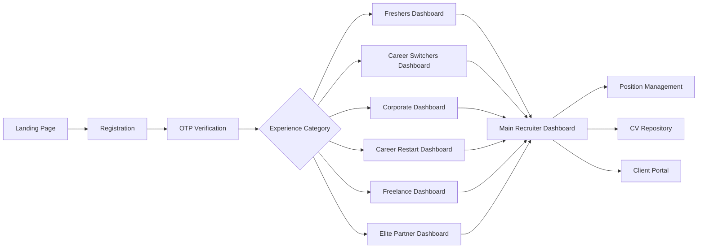

# RecruiterV - Professional Recruitment Platform

<div align="center">

**Empowering Recruiters to Build Successful Careers in Talent Acquisition**

[Features](#features) • [User Categories](#user-categories) • [Technology](#technology-stack) • [Security](#security--authentication) • [Support](#support)

---

</div>

## 🚀 Overview

**RecruiterV** is a comprehensive recruitment management platform designed to connect talented recruiters with opportunities across various career stages. Whether you're a fresh graduate entering the recruitment industry, a professional switching careers, or an established recruitment firm, RecruiterV provides the tools and resources needed to succeed in today's competitive talent acquisition landscape.

Our platform streamlines the entire recruitment lifecycle—from candidate sourcing to client management—while offering specialized pathways tailored to different experience levels and career goals.

---

## ✨ Features

### 🎯 Core Platform Capabilities

- **Multi-Tier User Management**: Specialized registration and onboarding flows for different recruiter categories
- **Smart OTP Verification**: Secure email-based authentication with seamless user verification
- **Dynamic Routing System**: Personalized dashboard experiences based on user experience category
- **Real-Time Dashboard**: Comprehensive recruiter dashboard with position tracking and candidate management
- **CV Repository**: Centralized candidate database with advanced search and filtering capabilities
- **Position Management**: Create, track, and manage job positions with detailed specifications
- **Client Portal**: Dedicated SPOC (Single Point of Contact) interface for client organizations
- **Admin Panel**: Powerful administrative controls for platform oversight and management

### 🔐 Security & Authentication

- **Firebase Integration**: Enterprise-grade authentication with automatic token refresh
- **Session Management**: Dual authentication strategy using Firebase tokens and backend session cookies
- **Secure OTP System**: Time-sensitive one-time passwords for account verification
- **Protected Routes**: Role-based access control ensuring data privacy and security
- **CORS & Credentials**: Secure cross-origin resource sharing with credential handling

### 📱 User Experience

- **Responsive Design**: Fully optimized for desktop, tablet, and mobile devices
- **Intuitive Navigation**: Clean, modern interface with streamlined user workflows
- **Real-Time Validation**: Instant form validation with helpful error messages
- **Progressive Loading**: Smooth loading states and transitions throughout the application
- **Accessibility**: Built with accessibility standards for inclusive user experience

---

## 👥 User Categories

RecruiterV caters to six distinct recruiter profiles, each with customized features and resources:

### 🎓 Freshers & College Pass-outs
*Perfect for recent graduates entering the recruitment industry*

Designed for individuals with little to no recruitment experience, this pathway offers guided onboarding, foundational training resources, and mentorship opportunities to kickstart your recruitment career.

### 🔄 Career Switchers
*For professionals transitioning into recruitment from other industries*

Tailored for experienced professionals looking to pivot into talent acquisition, featuring skill translation workshops, industry insights, and accelerated learning paths.

### 💼 Corporate Recruiters
*Built for in-house recruitment teams and HR professionals*

Comprehensive tools for internal talent acquisition teams, including ATS integration, bulk hiring capabilities, and employer branding resources.

### 🚀 Career Restart
*Supporting professionals returning to recruitment after a break*

Specialized support for individuals re-entering the recruitment field, with refresher programs, market updates, and flexible engagement options.

### 💻 Full-Time Freelancing
*Empowering independent recruitment consultants*

Complete freelance infrastructure including client management tools, invoicing systems, project tracking, and networking opportunities.

### ⭐ Elite Partner Program
*Exclusive partnership for established recruitment firms*

Premium tier offering white-label solutions, API access, dedicated account management, and enterprise-level features for recruitment agencies.

---

## 🏗️ Technology Stack

### Frontend Architecture
```
React 18.x          → Modern component-based UI framework
React Router 6.x    → Client-side routing and navigation
Axios               → HTTP client with interceptor support
Lucide React        → Modern icon library
Tailwind CSS        → Utility-first CSS framework
```

### Backend Integration
```
Firebase Auth       → User authentication and authorization
Custom REST API     → Backend services and data management
Session Cookies     → Persistent authentication state
```

### Key Technical Features
- **Token Refresh Strategy**: Automatic Firebase token renewal with fallback to session authentication
- **Request Interceptors**: Global axios interceptors for seamless auth token injection
- **Error Handling**: Comprehensive error management with user-friendly messaging
- **Local Storage Management**: Secure client-side data persistence for user preferences
- **Form Validation**: Real-time validation with custom error states

---

## 🎨 User Interface Highlights

### Modern Design Language
- **Color Palette**: Professional blue-orange-white gradient theme
- **Typography**: Clean, readable font hierarchy for optimal user experience
- **Iconography**: Consistent icon usage with Lucide React for visual clarity
- **Animations**: Smooth transitions and micro-interactions for enhanced UX

### Registration Experience
- **Multi-Step Process**: Seamless registration → OTP verification → category-based routing
- **Smart Validation**: Real-time field validation with helpful error messages
- **Password Security**: Toggle visibility feature for user convenience
- **Phone Formatting**: Automatic 10-digit mobile number validation with country code
- **Visual Feedback**: Interactive radio button cards with selected state indicators

---

## 🔄 Application Flow



---

## 🛡️ Security & Compliance

### Data Protection
- **Encryption**: All sensitive data transmitted over HTTPS
- **Authentication**: Multi-layered authentication with Firebase and session management
- **Authorization**: Role-based access control (RBAC) for feature gating
- **Session Management**: Secure session handling with automatic timeout

### Privacy
- **Data Minimization**: Collect only necessary user information
- **User Consent**: Clear terms and conditions acceptance during registration
- **Access Control**: Strict permission-based data access policies

---

## 📊 Platform Routes

### Public Routes
```javascript
/                    → Landing page
/reg                 → User registration
/otp                 → OTP verification
/log_rec             → Recruiter login
/login/con           → Login terms & conditions
/reg/con             → Registration terms & conditions
```

### Category-Specific Routes
```javascript
/fresher             → Freshers dashboard
/switch-career       → Career switchers dashboard
/corporate           → Corporate recruiters dashboard
/restart             → Career restart dashboard
/freelance           → Freelance dashboard
/established         → Elite partner dashboard
/main/area           → Main area selection
/pricing             → Pricing plans
```

### Protected Routes
```javascript
/dash_rec            → Main recruiter dashboard
/cv_repo             → CV repository
/dash_view/:pos_id   → Position detail view
/clientspoc          → Client SPOC login
/ad_panel            → Admin panel
```

---

## 🎯 Key Differentiators

### 1. **Personalized Experience**
Unlike generic recruitment platforms, RecruiterV tailors the entire user journey based on experience level and career goals, ensuring relevant features and resources for each user segment.

### 2. **Comprehensive Career Support**
From entry-level training to enterprise partnerships, RecruiterV supports recruiters at every stage of their professional journey with category-specific tools and resources.

### 3. **Modern Technology Stack**
Built with cutting-edge web technologies ensuring scalability, performance, and excellent user experience across all devices.

### 4. **Security First**
Enterprise-grade security with Firebase authentication, automatic token management, and robust session handling protects both recruiters and candidate data.

### 5. **Intuitive Design**
Clean, modern interface with thoughtful UX patterns makes complex recruitment workflows simple and efficient.

---

## 📈 Use Cases

### For Individual Recruiters
- Build and manage your candidate pipeline
- Track job positions and client interactions
- Access industry resources and training materials
- Connect with potential employers or clients

### For Recruitment Teams
- Collaborate on candidate sourcing and screening
- Share CV databases across team members
- Manage multiple client accounts efficiently
- Track team performance and metrics

### For Recruitment Firms
- Onboard and manage recruiter teams
- White-label platform capabilities
- API integration with existing systems
- Enterprise-level reporting and analytics

---

## 🌟 Success Metrics

RecruiterV measures success through:

- **User Engagement**: Active recruiter participation and platform usage
- **Placement Success**: Number of successful candidate placements
- **Client Satisfaction**: Client retention and feedback scores
- **Career Progression**: Recruiter advancement within the platform tiers
- **Platform Growth**: New user acquisition across all categories

---

## 🤝 Support

### For Recruiters
- **Help Center**: Comprehensive documentation and FAQs
- **Live Support**: Real-time assistance during business hours
- **Training Resources**: Video tutorials and best practice guides
- **Community Forum**: Connect with fellow recruiters

### For Clients
- **Dedicated SPOC**: Single point of contact for all recruitment needs
- **Custom Solutions**: Tailored recruitment strategies
- **Regular Updates**: Progress reports and candidate pipeline reviews
- **Feedback Loop**: Continuous improvement based on client input

### For Partners
- **Account Management**: Dedicated partner success managers
- **Technical Support**: Priority technical assistance
- **Business Development**: Co-marketing and growth opportunities
- **API Documentation**: Comprehensive integration guides

---

## 📞 Contact

**RecruiterV Platform**

For business inquiries, partnerships, or support:
- Email: support@recruiterv.com
- Website: www.recruiterv.com
- LinkedIn: linkedin.com/company/recruiterv

---

## 📜 Legal

### Terms & Conditions
All users must agree to our Terms & Conditions during registration. View our complete terms at `/reg/con`

### Privacy Policy
We take data privacy seriously. Read our Privacy Policy to understand how we protect your information.

### Compliance
RecruiterV complies with applicable data protection regulations and employment laws in all jurisdictions where we operate.

---

## 🎉 Join RecruiterV Today

Whether you're starting your recruitment career, switching industries, or scaling your recruitment firm, RecruiterV provides the platform, tools, and community to help you succeed.

**Get started today and transform your recruitment career!**

---

<div align="center">

**Built with ❤️ by the RecruiterV Team**

*Empowering Recruiters, Connecting Talent*

</div>